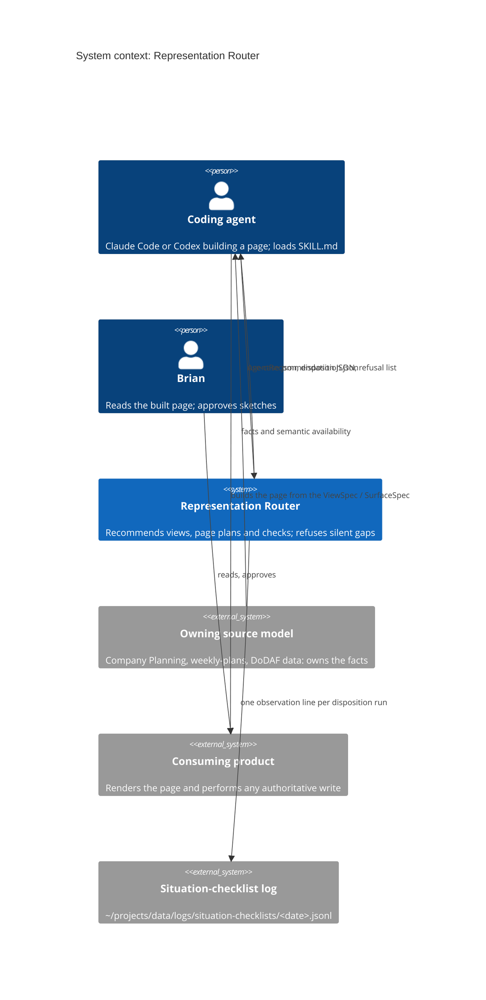
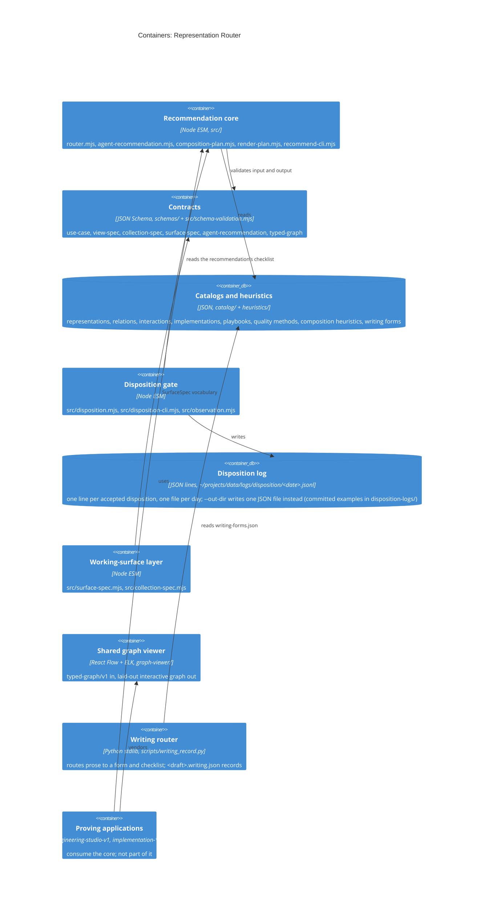

# Representation Router system model

Sections follow arc42 (1, 3, 5, 6, 8, 10) with C4 diagrams in Mermaid. The checked twin is
[trace.yaml](trace.yaml): every rule below has one owner file, its tests and its decision
record. Covered scope: the reusable core (`src/` recommendation, disposition, contracts),
`graph-viewer/` and `scripts/writing_record.py`. Not modelled: the proving applications
(`review-workbench*`, `engineering-studio-v1`, `implementation-*` (archived ones: `docs/archived-apps.md`),
`weekly-review`, the Self Map) and the public export script; they consume the core and are
listed only as containers.

## 1. Goals

What the router is for, its quality goals and stakeholders: [GOAL.md](../architecture/GOAL.md).
Questions this model should answer: which code turns a use case into a recommendation, which
code refuses an incomplete disposition and what it writes, where a write-authority boundary
is enforced, and which tests prove each rule can fail.

## 3. Context and Scope

The router reads a use case (the person's question plus the facts about the source model)
and its own reviewed catalogs; it prints recommendations and writes disposition records.
The facts, planning state and any authoritative write stay with the consuming product.

## 5. Building Blocks

Stored state that matters: the catalogs and heuristics (reviewed knowledge, edited by hand
and pinned by `test/catalogs.test.mjs`), the daily disposition log outside the repository (`~/projects/data/logs/disposition/<date>.jsonl`; `--out-dir` writes one file per record instead, and `disposition-logs/` keeps such committed examples), the
writing records beside each draft, and the daily observation log outside the repository.
The recommendation itself is printed, not stored.

## 6. Runtime View

**PROC-RECOMMEND** (`npm run recommend`), enforces RULE-CONTRACT-VALIDATED and
RULE-SEMANTIC-UNAVAILABLE-REJECTS:

1. `src/recommend-cli.mjs:25` validates the use case (`assertContract("use-case", ...)`,
   defined at `src/schema-validation.mjs:299`); a malformed file exits 1 before routing.
2. `src/recommend-cli.mjs:63` calls `buildAgentRecommendation`; it routes at
   `src/agent-recommendation.mjs:326` through `route` (`src/router.mjs:243`), where
   `scoreCandidate` rejects every candidate when semantics are unavailable
   (`src/router.mjs:54`), builds the ViewSpec (`src/agent-recommendation.mjs:349`) and the
   page plan (`src/agent-recommendation.mjs:354`).
3. `src/recommend-cli.mjs:77` validates the output against the agent-recommendation schema
   and `emit` (`:88`) prints it, or writes it to the file named by `--out`. Nothing else is stored.

**PROC-DISPOSITION** (`npm run disposition`), enforces RULE-DISPOSITION-NO-SILENT-GAP,
RULE-CHOICE-JUSTIFIED, RULE-ACCEPTANCE-EVIDENCE and RULE-OBSERVATION-DAILY-APPEND:

1. With `--acceptance`, `src/disposition-cli.mjs` checks each approved reference's sha256
   against the bytes on disk and exits 1 on a mismatch.
2. `src/disposition-cli.mjs:74` collects the checklist (`collectChecklist`,
   `src/disposition.mjs:58`) and `:75` validates it (`validateDisposition`,
   `src/disposition.mjs:98`).
3. Refused: `src/disposition-cli.mjs:93` appends a not-ok observation and `:100` exits 1.
   Accepted: by default `src/disposition-cli.mjs:127` appends the record as one line to
   `~/projects/data/logs/disposition/<date>.jsonl` (`DISPOSITION_LOG_DIR` overrides, `:42`);
   with `--out-dir DIR` `:123` writes one file `DIR/<id>--<timestamp>.json` instead. Then
   `:130` appends an observation (ok unless a line says `failed`, which exits 3); the
   append itself is `src/observation.mjs:23`.

**PROC-SURFACE** (`buildSurfaceSpec`, `src/surface-spec.mjs:144`), enforces
RULE-SURFACE-WRITE-AUTHORITY: an `authoritative-write` action is refused at
`src/surface-spec.mjs:112` unless it carries destination, subject revision, authority, a
stale-submission policy and evidence retention. Returns a SurfaceSpec; writes nothing.

**PROC-GRAPH** (graph viewer render), enforces RULE-TYPED-GRAPH-VALID: `graph-viewer/src/index.jsx:592`
refuses an invalid typed graph using `validateTypedGraph` (`graph-viewer/src/model.mjs:12`)
before ELK layout. Writes nothing.

**PROC-WRITING-RECORD** (`scripts/writing_record.py declare|observe|check|gaps`), enforces
RULE-WRITING-PASS-NEEDS-QUOTE: `cmd_observe` (`scripts/writing_record.py:175`) refuses a
pass whose quote is not in the draft (`:184`); `save` (`:71`) writes `<draft>.writing.json`;
`cmd_check` exits 1 while any item is open. When the facts give no route, `check` also exits 1
unless `declare --no-fit-governed-by PATH_OR_URL` recorded a `no_fit` disposition naming the
contract or authority that governs the writing; then only the medium's items apply and the log
row's form is `no_fit`. A no-route result without a governor, at `declare` or `check`, appends
a `catalog_gap` row (path and facts) to the daily log, and `gaps` (`cmd_gaps`) exits 1 while any
exist in the last N days.

## 8. Cross-cutting Concepts

- **Records.** UseCase (input, `schemas/use-case.schema.json`); ViewSpec, CollectionSpec,
  SurfaceSpec (contracts in `schemas/`); AgentRecommendation (printed);
  DispositionRecord v0.2 (`buildDispositionRecord`, `src/disposition.mjs:161`); observation
  row (`observationRow`, `src/observation.mjs:8`); writing record (`<draft>.writing.json`);
  typed graph (`typed-graph/v1`). Three more schemas sit in `schemas/` outside the core flows:
  `architecture-view-candidate.v0` (experimental, read by `src/architecture-candidate.mjs` for the T3B
  provider boundary), `interface-pattern-catalog` (shape of `catalog/interface-patterns.json`, pinned by
  `test/catalogs.test.mjs`) and `render-qa-config` (describes the hand-written `render-qa.json` files that
  `scripts/render-qa.mjs` reads, such as `weekly-review/render-qa.json`; no code validates against it).
- **Truth stays with the owner.** Stable semantic IDs and source bindings come from the
  owning model; the router never remaps by display label and never writes to the source
  ([Decision 0002](../decisions/0002-truth-and-writes-stay-with-the-owner.md)).
- **Advisory score.** Scores and heuristic weights rank candidates but do not decide; when
  alternatives exist the disposition must justify the choice
  ([docs/composition.md](../composition.md)).
- **Views.** The recommend CLI output (shows the primary, alternatives, avoid list, page
  plan and checks); the disposition CLI output (shows missing and invalid items, or the log
  path); the graph viewer (shows a typed graph's nodes, edges and hyperedges); the public
  page in `public/` (runs the router for visitors).

## 10. Quality Requirements

Observable patterns if the system works:

- A use case marked `unavailable` yields no primary representation; the rejected list names
  the missing semantics (observable in `npm run recommend` output; `test/router.test.mjs`).
- A disposition that omits one named item exits 1 and writes no record: the day's
  disposition log gains no line (observable in `~/projects/data/logs/disposition/`;
  `test/disposition.test.mjs`).
- Observation lines for one day land in one file, never one file per run
  (`test/observation.test.mjs`).
- A SurfaceSpec with an authoritative write and no subject revision throws, so no surface
  carries an ungrounded Approve action (`test/surface-spec.test.mjs`).
- Every node of a valid typed graph has a position and every edge a route after layout
  (`test/graph-viewer.test.mjs`).
